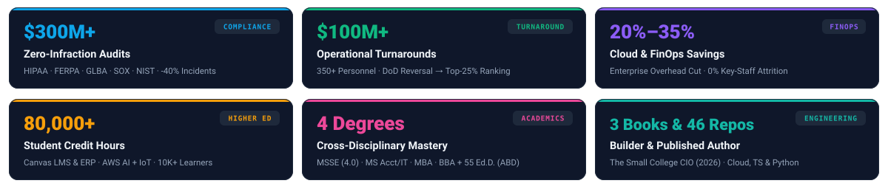
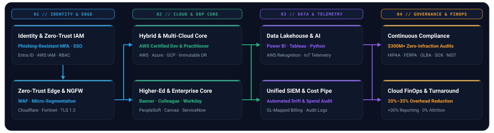
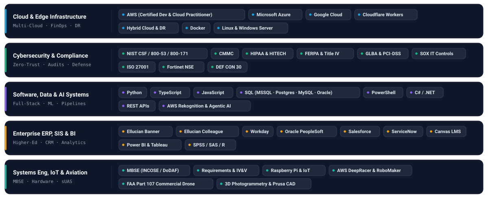

<picture>
  <source media="(prefers-color-scheme: dark)" srcset="./assets/hero-dark.svg" />
  <source media="(prefers-color-scheme: light)" srcset="./assets/hero-light.svg" />
  
</picture>

  

---

### Terminal // Executive Systems Briefing

  

---

### Telemetry // Verified Impact at Enterprise Scale

<picture>
  <source media="(prefers-color-scheme: dark)" srcset="./assets/impact-dark.svg" />
  <source media="(prefers-color-scheme: light)" srcset="./assets/impact-light.svg" />
  
</picture>

---

### Architecture // Regulated Multi-Cloud & Higher-Ed Governance Stack

<picture>
  <source media="(prefers-color-scheme: dark)" srcset="./assets/architecture-dark.svg" />
  <source media="(prefers-color-scheme: light)" srcset="./assets/architecture-light.svg" />
  
</picture>

---

### Arsenal // Full-Spectrum Engineering, Cloud & Leadership Stack

<picture>
  <source media="(prefers-color-scheme: dark)" srcset="./assets/tech-arsenal-dark.svg" />
  <source media="(prefers-color-scheme: light)" srcset="./assets/tech-arsenal-light.svg" />
  
</picture>

---

### Blueprints // Published Frameworks & Featured Work

<table>
  <tr>
    <td width="33.3%" valign="top">
      <h4>📘 <em>The Small College CIO</em> (2026)</h4>
      
Comprehensive 10-chapter leadership handbook for higher-ed CIOs &amp; VPs of Technology managing lean budgets, accreditation (SACSCOC/Title IV), cyber defense, and faculty AI innovation.

      <a href="./blueprints/small-college-cio-playbook.md"><strong>→ Read Executive Playbook</strong></a>
    </td>
    <td width="33.3%" valign="top">
      <h4>🛡️ Regulated Cloud Zero-Trust</h4>
      
Unified security &amp; audit architecture harmonizing <code>NIST 800-53/171</code>, <code>CMMC</code>, <code>HIPAA</code>, <code>FERPA</code>, <code>GLBA</code>, and <code>SOX</code> — battle-tested across <strong>$300M+</strong> in zero-finding audits.

      <a href="./blueprints/regulated-cloud-zero-trust-architecture.md"><strong>→ View Control Architecture</strong></a>
    </td>
    <td width="33.3%" valign="top">
      <h4>📊 FinOps &amp; Crisis Turnarounds</h4>
      
Systems Engineering + GAAP/Managerial Accounting methodology used to recover <strong>20%–35%</strong> in redundant cloud/vendor overhead while maintaining <strong>0% key-staff attrition</strong>.

      <a href="./blueprints/cloud-finops-turnaround-framework.md"><strong>→ Explore FinOps Framework</strong></a>
    </td>
  </tr>
</table>

> **Open-Source Curation:** Creator &amp; maintainer of [`Awesome-Assemblies-of-God-Church`](https://github.com/JSilvaLabs/Awesome-Assemblies-of-God-Church) ([**Live Searchable Directory**](https://jsilvalabs.github.io/Awesome-Assemblies-of-God-Church/)), plus 40+ active engineering, analytics, theology pedagogy, and operational estimation repositories across TypeScript, Python, SQL, and cloud-native web stacks.

---

### Credentials // Academic, Executive, Cloud & Military Track Record

<strong>Expand Full Academic Degrees (5 Conferred), Cloud/Cyber Certifications, Publications &amp; Military Honors</strong>

 

| Category | Verified Credentials &amp; Distinctions |
| :--- | :--- |
| **5 Conferred Degrees &amp; Doctoral Study** | • **M.S. in Systems Engineering** — The University of Texas at El Paso (**4.00 GPA**) • **M.S. in Accounting &amp; Information Technology** — Texas State University • **Master of Business Administration (M.B.A.)** — The University of Texas at San Antonio • **B.B.A. in International Business** &amp; **Bachelor's in Economics** — The University of Texas at San Antonio (*2 Bachelor's Degrees · 137 Credit Hours*) • **Doctoral Coursework:** 55 earned doctoral credits toward **Ed.D. in Organizational Leadership** (*All But Dissertation / ABD — Degree Not Conferred*) |
| **Cloud &amp; Cybersecurity** | • **AWS Certified Developer – Associate** &amp; **AWS Certified Cloud Practitioner** • **7 AWS Storage, Migration &amp; Resilience Badges** (Core, S3/Glacier, EBS, EFS/FSx, DR, Data Migration) • **Fortinet Network Security Associate (NSE 1)** · **DEF CON 30** Aerospace &amp; Hardware Badges · **500+ hrs AWS Labs** • **AWS AI/Robotics Badges:** DeepRacer, DeepLens, RoboMaker, IoT, Inventor |
| **Leadership &amp; Turnarounds** | • **VP of Project Management &amp; CTO**, [RegulatedCloud](https://regulated.cloud) (Austin, TX) — *20%–35% overhead savings, -40% security incidents* • **Technology Fellow**, Texas State University — *Canvas LMS migration, AWS Rekognition + IoT classroom AI (80,000+ SCH)* • **Chief Finance &amp; Technology Officer (CFTO)**, AOMA Graduate School — *$100K annual savings/revenue, $25K in 48 hrs, 0% attrition* • **Intelligence Officer**, U.S. Army Reserves (*Combat Veteran — Afghanistan*) — *$100M / 350-person logistics turnaround (Last → Top 25%)* |
| **Military &amp; Civil Honors** | • Meritorious Service Medal · Army Commendation Medal · Army Achievement Medal · Combat Action Badge · Afghanistan &amp; NATO Medals • **FAA Part 107 Licensed Commercial sUAS Drone Pilot** · **Prusa 3D Printing Certified** · **QuickBooks Advanced ProAdvisor** |
| **Published Books** | • *The Small College CIO: A Practical Guide to IT Leadership in Resource-Constrained Environments* (2026) • *2025 &amp; 2026 Old Testament Textbooks* (UPLCII National Curriculum) |

---

### GitHub Telemetry // Live Coding & Commit Velocity

  <picture>
    <source media="(prefers-color-scheme: dark)" srcset="https://github-profile-summary-cards.vercel.app/api/cards/profile-details?username=JSilvaLabs&theme=tokyonight" />
    <source media="(prefers-color-scheme: light)" srcset="https://github-profile-summary-cards.vercel.app/api/cards/profile-details?username=JSilvaLabs&theme=default" />
    
  </picture>
  <picture>
    <source media="(prefers-color-scheme: dark)" srcset="https://streak-stats.demolab.com?user=JSilvaLabs&locale=en&mode=daily&theme=tokyonight&hide_border=true&border_radius=10" />
    <source media="(prefers-color-scheme: light)" srcset="https://streak-stats.demolab.com?user=JSilvaLabs&locale=en&mode=daily&theme=default&hide_border=true&border_radius=10" />
    
  </picture>

 

  Built with systems engineering precision by <strong>Joshua David Silva, M.S., M.B.A.</strong> — Austin &amp; San Antonio, TX — Always shipping alongside <a href="https://regulated.cloud">RegulatedCloud</a> &amp; <a href="https://github.com/Funkmyster">@Funkmyster</a>.

