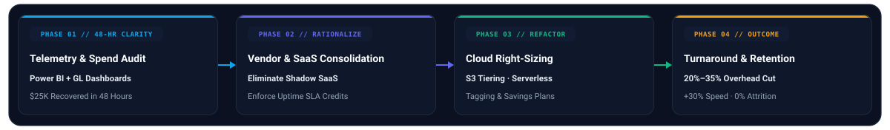

# Cloud FinOps & Operational Turnaround Framework (20%–35% Overhead Reduction)

**Author:** Joshua David Silva, M.S., M.B.A. (*M.S. Systems Engineering [4.0 GPA] · M.S. Accounting & IT · M.B.A.*)

Most cloud optimization efforts treat cost as a purely engineering exercise—or purely an accounting cut. Real executive turnarounds combine **Systems Engineering architecture** with **GAAP / Managerial Accounting unit economics** so performance rises while burn drops **20%–35%**.

<picture>
  <source media="(prefers-color-scheme: dark)" srcset="../assets/blueprint-finops-dark.svg" />
  <source media="(prefers-color-scheme: light)" srcset="../assets/blueprint-finops-light.svg" />
  
</picture>

## Four-Phase Turnaround Methodology

1. **48-Hour Executive Visibility (`Time-to-Clarity`)**
   - Deploy real-time Power BI / cloud billing + GL-mapped budget dashboards directly to department heads.
   - *Field Benchmark:* At **AOMA Graduate School of Integrative Medicine (CFTO)**, real-time budget automation recovered **$25,000 in redundant services within 48 hours** and unlocked **$100,000 in annual savings + revenue enhancements**.
2. **Contract Renegotiation & Portfolio Rationalization**
   - Eliminate duplicate VoIP, MSP, backup, and SaaS licensing across multi-campus sites; tie vendor SLAs to measurable uptime penalties.
3. **Systems-Engineered Cloud Architecture Optimization**
   - Enforce tagging governance, storage lifecycle policies (S3 Intelligent-Tiering / Glacier), serverless event-driven compute, and Savings Plans — delivering **20%–35% recurring cloud & IT overhead reduction** at **RegulatedCloud**.
4. **Human-Centered Change & Retention Engineering**
   - Technical turnarounds fail when key engineers walk out the door. Pair cost discipline with individualized career-growth plans and cross-training (**proven 0% attrition over 6 months** post-mandatory pay cuts; revitalizing a **350-person / $100M U.S. Army logistics battalion** from bottom tier to **Top 25% nationwide**).