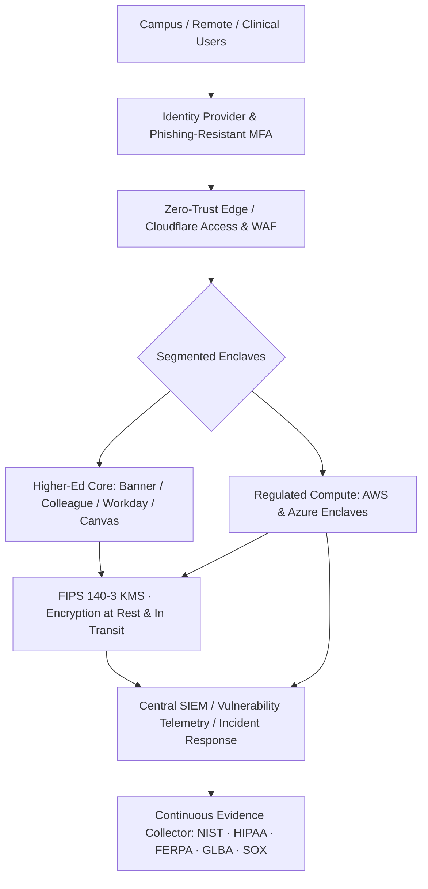

# Regulated Multi-Cloud & Zero-Trust Reference Architecture

**Author:** Joshua David Silva, M.S., M.B.A. — VP of Project Management & CTO, [RegulatedCloud](https://regulated.cloud)

Organizations operating across higher education, healthcare, financial services, and defense contractors face overlapping compliance mandates (`NIST SP 800-53 / 800-171`, `CMMC`, `HIPAA`, `FERPA`, `GLBA`, `PCI-DSS`, `SOX`, and `ISO/IEC 27001`). Instead of building brittle point-solutions per regulation, this architecture unifies controls into a **single automated Zero-Trust control plane**.

## Unified Control Mapping Matrix

| Security Domain | Reference Controls | Engineering Implementation | Frameworks Satisfied |
| :--- | :--- | :--- | :--- |
| **Identity & Access** | Least privilege, conditional access, RBAC/ABAC | Phishing-resistant MFA, short-lived STS tokens, Entra ID / AWS IAM Identity Center | NIST AC-2/AC-3, GLBA, HIPAA, SOX |
| **Network Segmentation** | Default-deny micro-perimeters | Separate enclaves for Student Info (FERPA), ePHI (HIPAA), Financial ERP (SOX/GLBA), and CUI | NIST SC-7, CMMC, PCI-DSS, Fortinet NGFW |
| **Cryptography & Keys** | Immutable audit logs, envelope encryption | Customer-managed KMS keys, TLS 1.3 everywhere, encrypted RDS/S3 with object lock | HIPAA, FERPA, GLBA Safeguards Rule |
| **Resilience & DR** | Tested RTO/RPO recovery runbooks | Cross-region AWS Backup, immutable air-gapped snapshots, quarterly tabletop exercises | NIST CP-9/CP-10, ISO 27001 A.17 |
| **Continuous Audit** | Automated drift & compliance evidence | Infrastructure-as-Code compliance checks, automated IAM & vulnerability attestation | Passing **$300M+ enterprise IT audits with zero infractions** |

## Proven Field Outcomes
- **-40% reduction in security incidents** across regulated enterprise and multi-campus higher-education environments.
- **$300M+ in audited enterprise IT operations** passed with zero regulatory findings across HIPAA, FERPA, SOX, GLBA, and DoD Information Assurance.